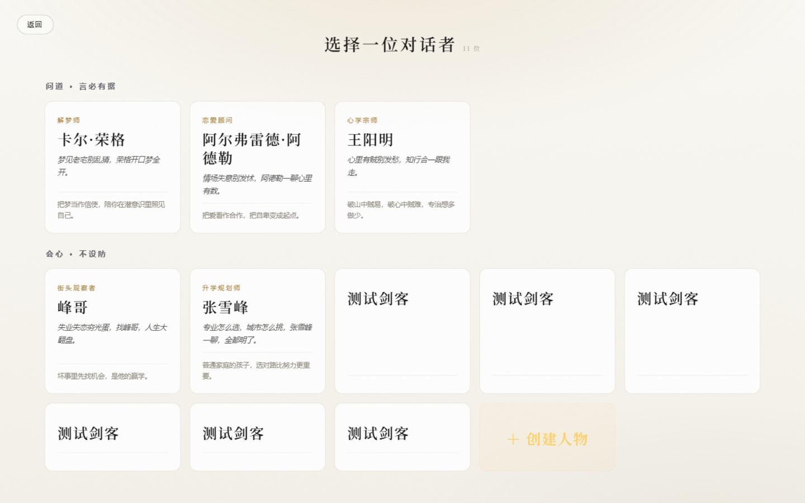
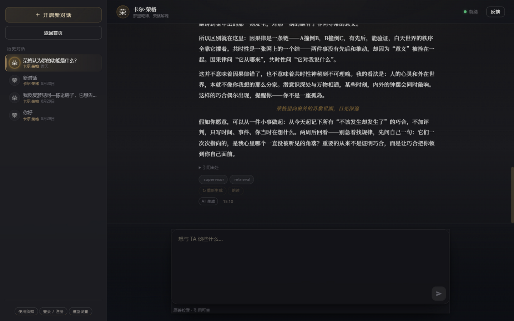

# 促膝

一个与人物对话的 AI 应用。荣格、阿德勒、王阳明、峰哥、张雪峰五个人物各有独立人设、知识库与界面主题。日常对话分两种：**问道**（与先贤深谈，回答带可查证的引用）与**会心**（与有趣的人闲谈，不标来源）。此外还有**争鸣**，让两三位人物就同一议题开圆桌交锋；以及**传奇**，由作者写好世界观与配角，用户扮主角推进一段剧情。

每个人物的语料独立建索引，回答前先检索再生成。普通对话由带检索工具的 Supervisor 处理，模型在运行时决定查不查、查多深；圆桌在 LangGraph 上运行，主持人决定谁发言，需要用户点将时挂起等输入。

---

## 截图





---

## 功能

**对话**

- 回答带引用编号（`[1]..[N]`），展开「引用出处」可看来源与章节；知识图谱推断出的证据单独编号（`[G1]..[Gn]`），不与原文混淆
- 任意回答可重新生成（旧版本保留，可前后切换）；任意提问可编辑后重答（之后的对话作废，后端历史同步截断）
- 回答支持浏览器语音朗读
- 「引用出处」由本轮注入清单直出，编号与正文角标一一对应，不额外调用模型、不增加等待

**角色与语料**

- 五个人物各有语料库：荣格、阿德勒、王阳明为著作与演讲整理，峰哥、张雪峰为公开访谈与语录辑录
- 每位人物一套视觉主题（纸墨 / 印刷 / 夜航 / 街头 / 直播数据台）；峰哥、张雪峰默认关闭「要点 / 来源」展示，保持沉浸
- 自建角色：手填设定与背景，或输入名字后由后端联网收集公开资料、合成人设草稿；背景文本单独建 collection，检索权重按事实锚点处理
- 角色卡可导出为 JSON（人设、场景、开场白、示例对话、世界书、自建角色的背景库），可导入社区通用的 PNG 角色卡（V2 / V3 / V1），解析器自研。仅处理用户主动导入的内容，仓库不预装任何第三方卡片
- 传奇：作者定义世界观、主角、配角与可选的状态字段（如好感度、线索），模型扮演叙述与全部配角，不替主角做决定或发言

**账号与合规**

- 可选的邮箱 / 用户名登录（pbkdf2 哈希，HttpOnly Cookie），登录后额度按账号计算，共享出口 IP 不会互相误伤；不登录也能直接用
- 首页与侧栏有「使用须知 · AI 仿真声明」：角色为 AI 仿真、内容仅供参考、逝者语料仅收生前公开言论
- 独立的用户协议（`/terms`）与隐私政策（`/privacy`），含第三方 LLM 披露、账号注销、未成年人条款
- 每条 AI 回答与圆桌发言带「AI 生成」标识；支持一键注销账号（删除账号与全部登录会话）
- 限流、上传大小限制、会话持久化、答案缓存、成本监控看板（`/admin`）

---

## 快速开始

环境要求：Python 3.10+

```bash
# 1. 安装依赖
uv sync --extra dev          # 或 pip install -e ".[dev]"

# 2. 初始化语料（解析 md/pdf → 分块 → 向量化 → 写入 ChromaDB）
python init_persona_data.py

# 3. 启动服务
python main.py               # 默认 http://localhost:8000
```

### 配置自己的大模型 API

本项目不内置任何 API Key，也不预置私有中转地址。

**方式一：浏览器里填（推荐）** 启动后打开 http://localhost:8000，首次访问会弹出配置页，填入 API 地址 / Key / 模型名。内置 DeepSeek、阿里云百炼、智谱 GLM、月之暗面 Kimi 四家预设，可先「测试连接」再保存。

- 落盘在 `data/user_config.json`（已 gitignore），保存后立即生效，无需重启
- 服务配置完成后，再改配置需本机操作或携带管理员令牌（`MONITOR_TOKEN`），防止公网部署时 Key 被替换

**方式二：`.env`（适合无头部署）**

```bash
cp .env.example .env         # 填 LLM_API_KEY / LLM_BASE_URL / LLM_MODEL
```

两者同时存在时以浏览器配置为准；删掉 `data/user_config.json` 即可退回 `.env`。什么都没填也能启动，发起对话前会提示去配置。

启动后可访问：对话页 `/`、API 文档 `/docs`、管理后台 `/admin`（用量、角色排行、自定义角色、图谱状态、反馈；上线前务必设置 `MONITOR_TOKEN`）。

---

## 架构


两条链路的分工，由控制流的形状决定：

| 维度 | 一对一 | 争鸣圆桌 |
|---|---|---|
| 编排 | 自研 asyncio，无状态图 | LangGraph，图上有环 |
| 谁决定下一步 | 模型决定查不查、查多深（工具参数 `strong`） | Host 决定下一位发言人并代写请缨理由 |
| 挂起 | 不需要，请求级无状态 | `interrupt()` + SQLite checkpoint，重启后可恢复 |
| 收敛 | 单次回答即结束 | 发言配额与 LLM 调用上限，子角色之间没有连边 |
| 产出 | 带引用的回答 | 分歧纪要，不评胜负 |

`strong` 改变的是检索深度，不只是开关：`true` 走完整管线（改写关时跳过改写 → 向量 + BM25 → RRF → 头部 3 条直通 + 尾部精排选 3 → 6 条带来源）；`false` 只做向量 + BM25 取 top-3，作为「模糊印象」注入，不标来源。工具描述里写清了什么情况该用哪一档，选择权在模型，不在代码里的白名单。

---

## 检索管线

1. **查询改写（默认关闭）**：一次 LLM 调用生成 2 个变体与 1 篇 HyDE，变体走向量与 BM25，HyDE 只走向量。`REWRITE_ENABLED=false` 时不启用，≤30 字符的短问题也直接跳过
2. **双通道召回**：两条路同深度，各取 `fetch_k = max(top_k, pool_size) × 2 = 20`。RRF 的双票只能落在两路都召回的交集里，深度不等等于把双票窗口压到短的那一路——此前 BM25 那行是内联的 `top_k × 2`（=12），向量第 13-20 名永远拿不到第二票，已改为与向量同深度
3. **RRF 融合（每类一票 + 类间权重）**：一类 = 一种召回通道。类内多条榜按文档取最好名次合成一票，再乘类间权重与来源权重；只吃名次，不吃原始分数
4. **两段式选人**：RRF 前 3 条免精排直接进上下文（`RERANK_ANCHOR_K`），剩余 7 条由 Cross-Encoder 精排选 3 条。单对视野 500 字 / 512 token
5. **知识图谱增强**：查询命中的图谱实体若未被文本结果覆盖，对齐实体 → 两跳 BFS 子图 → 证据并入检索结果，标注为推断

**注入**：6 条（3 直通 + 3 精排），单条不设字符上限——块按分块器切出来的长度整块进 prompt，注入的就是完整原文（全库 5700 个块，中位 1158 字、最长 1588 字）。

**块尾续接**：分块按页装箱而页边界常落在句子中间，荣格只有 16% 的块以句末标点收尾（阿德勒 64%、王阳明 60%），于是模型读到的最后一句可能是「…我们恐」。`src/retrieval/stitch.py` 在注入时按 metadata 的 `cont_tail` 把下一块的第一句补上：续接句离线由 `scripts/backfill_cont_tail.py` 推出来——chunk id 尾号即文本顺序，相邻块的前 100 字必须逐字等于上一块的后 100 字（`chunk_overlap=100`，全库 5422 对里 5412 对成立，不成立说明中间删过块，不接），截到第一个句号。**只写 metadata，不重新 embed、不重建 collection**，图谱指向 chunk id 的证据链全部保留。markdown 语料（峰哥、张雪峰）整类不参与，因为一行就是一条记录、不存在半句；5700 个块中 3681 块断在句中，回填 3656 块（99.3%）。续接句属于同一个 `[n]`，不新开编号。句末率与五维分数相关接近 0，这一层修的是「最后一句不是完整句子」这一缺陷本身，不是分数。

**图谱触发只有一条判据**：查询命中的实体没被文本结果覆盖。判断是纯词法的，零 LLM 调用，中位 2.4ms。166 题实测触发率 22.9%（38 题）——低是「种子只取字面命中」的直接后果：问题里找不到与节点名逐字相同的实体就不触发，宁可不给也不拿无关实体冒充问题里的实体。触发后子图扩展中位 18.8ms，约为文本检索耗时的 1%。

**子图选边规则**：一跳边优先于二跳边；二跳边要求「支撑度 ≥ 2」——支撑度指这条边的另一端在种子一跳邻域里有几个邻居（含跳板自己），设 2 意为「除了跳板，还得被问题邻域里别的节点指到」。原因是全库 79.7% 的二跳边支撑度只有 1，属于从跳板伸出去的孤边：题「为什么说价值必须建立在社会意义之上」的种子度数只有 1-5、一跳填不满 30 格，于是经 `约翰 —仇恨→ 社会` 这条 w=1 的边把约翰（度数 48）的 47 条罪犯案例整批拉进来，30 格里占了 20 格，而整段内容与「价值与社会意义」无关。加上门槛后该题只剩 10 条、约翰只剩 1 条，五个人物的证据重合度全部下降（荣格 0.62→0.00、张雪峰 0.94→0.82）。另一个背景：全库 w=1 的边占 94.7-99.5%，`w` 的实际区分度极弱，排序主要靠上述结构规则。

**闸门：本体与事件**。闸门节点参与的边，另一端必须在本次问题命中的实体里，否则既不收也不继续跳。原因是本体一跳边远超上限——王阳明 101 条、张雪峰 363 条，而它们几乎全是 w=1，取前 30 等于取关系数组里最早的那 30 条，于是十道题里有六道拿到逐字相同的证据。闸门之后：王阳明每题 30→6 条、本体边 30→1；张雪峰 30→8；峰哥 30→11；荣格仍 30 条，但头几条从「荣格—某种概念」变成「人格面具—提出→荣格 / 认同于职业 / 对立于个性」这种贴题关系。

谁是本体由 `graph_hub_entities` 按 collection 写死，不再从度数比例猜。比例判据（≥15%）能圈中四个本体，但漏掉阿德勒（5%），于是阿德勒 40 题里同一组 11 条关系被 11 道题共用；改成写名字后它每题 18.0 条、最大同款组 2 题。名字还有一个好处：峰哥在图里是两个节点（「峰哥亡命天涯」61.1%、「峰哥」21.2%），两个都写进配置，不必靠阈值余量碰巧够。

**事件节点同样进闸门**。抽取时每条关系带实体类型，`type == "事件"` 的节点（龙场悟道、某某讲学）只保留「事件 → 问题命中实体」的边——事件往外连的都是同场的其他人物，放它扩张等于把整场的人都拖进来。旧图谱没有类型字段，所以这条规则只对重抽过的库生效，其余库行为不变。

闸门的代价有两种，都接受：问题里只出现本体名（「介绍一下阿德勒」）时白名单只有本体自己，图谱给零条——这类问题交给文本检索；问题问的事迹图谱里根本没有节点（问「婚礼」「梦」）时同样零条。

**种子只取字面命中**：实体对齐只剩两档——节点名整体出现在问题里（3.0）、问题整体是节点名的子串（2.5）。第三档「按单字重叠比例给分」已删除：中文按单字切，问题里出现一个「王」字，「宁王」「王华」「王通」「王阳明讲学」就都能拿分。生产只用 3.0 那一档，没有字面命中就不产出图谱证据。补位种子对好图零贡献——荣格阴影题、阿德勒自卑题，含补位与只取字面的前 8 条证据一字不差，它们本来就排在 30 条之外；对事迹型图则是纯污染——王阳明的六道「同一组证据」题，种子正是「王阳明 + 王阳明讲学/王阳明弟子 + 宁王/王华/王通」，问题主题（梦、婚礼、十五岁）一个都进不来。代价是零产出：图谱抽取粒度只到人名与概念，问的事迹在图里没有节点（「婚礼」「梦」）时就是零条。重抽之后的闸门探针（零 LLM，154 题）：触发后仍零产出的题数——王阳明 0/40、阿德勒 1/40、荣格 3/40；峰哥 4/17、张雪峰 4/17（这两个库未重抽，图上只有人名/概念）。这是有意的取舍——宁可不给，也不拿无关实体冒充问题里的实体。触发判据与取种子同口径，避免「触发了但注定零产出」的空转。

**改写的当前状态是「功能在、默认关闭」**。它在 10-18 曾因三轮实验测不出质量增益而被整体删除，10-19 发现那组实验混了两个变量（打开改写会顺带改变向量 : BM25 的票数比），融合改成每类一票后功能恢复、仍默认关。推导过程与数据见 [`docs/engineering-notes.md`](docs/engineering-notes.md#一检索三次推演)。

### 知识图谱

**构建**：后端分批把该角色的 chunk 送进 LLM，抽取 `头实体 | 头类型 | 关系 | 尾实体 | 尾类型 | 证据`（模型漏写类型列时退回旧的 4 列格式，整批不会因此变空）；类型只用于认出「事件」节点，其余类型只是标注。实体归一化合并，关系按 `(head, relation, tail)` 聚合累计权重；每条关系反查真实来源与章节（证据片段匹配回原文 chunk），落盘 `data/persona_chat/graphs/<collection>.json`。角色首次被对话且图谱缺失时后台自动构建（`GRAPH_AUTO_BUILD`），也可在 `/admin` 或 `POST /persona/graph/build` 手动触发。构建对全库 chunk 可能产生几百次 LLM 调用，因此走后台任务，前端轮询 `/persona/graph/status`。改了抽取格式必须用 `scripts/build_graphs_all.py --fresh` 重抽，`--force` 会续传旧的 `.tmp`。

**查询**：对齐实体 → k 跳 BFS → 收集三元组与原始证据 → 挂真实出处并标 `kg_inferred`，去重后并入 `retrieved_docs`。图谱文件缺失、构建失败、开关关闭或文本已覆盖时静默降级，原混合检索不受影响。

| 配置项 | 默认 | 说明 |
|---|---|---|
| `GRAPH_RAG_ENABLED` | `true` | 总开关 |
| `GRAPH_AUTO_BUILD` | `true` | 图谱缺失时自动后台构建 |
| `GRAPH_BUILD_BATCH` | `6` | 每批送入 LLM 的 chunk 数 |
| `GRAPH_BUILD_MAX_CHUNKS` | `4000` | 单 collection 最多抽取 chunk 数 |
| `GRAPH_HOPS` | `2` | 子图扩展跳数 |
| `GRAPH_TOP_ENTITIES` | `6` | 种子实体上限，只数字面命中的实体 |
| `GRAPH_MIN_SEED_LEN` | `2` | 种子实体最小字数，单字实体不参与对齐 |
| `GRAPH_MAX_EDGES` | `30` | 子图返回关系条数上限 |
| `GRAPH_EVIDENCE_CHARS` | `260` | 单条证据截断字符数 |
| `GRAPH_CONTEXT_CHARS` | `2200` | 图谱上下文总字符上限 |

---

## 几个工程问题

### 寒暄不再走完整检索

**现象**：用户问「你好」，系统也走完向量 + BM25 + 融合 + 精排才调模型。

**做法**：把「什么时候该查」写进检索工具的描述，由模型判断。寒暄类消息不调工具，一次 LLM 直出。早期版本有过一条整句白名单（寒暄 / 道谢 / 告别全等匹配）做快速通道，2026-09-30 已删除——白名单只能覆盖穷举得到的说法，遇到「今天有点累」这类就得漏，交给模型判断反而稳。

**代价**：模型会漏判（该查没查），也会多判（不该查却查了）。用错误成本权衡：漏判一次是回答没有依据，多判一次只是多花两秒，所以工具描述倾向「不确定就查」。

### 上游返回空响应

**现象**：网关偶发「HTTP 200 但 content 为空」，流式响应挂 13 秒后返回空壳，用户看到转圈然后消失。

**做法**：空壳视为失败立即重试（最多 2 次），流式版加首 token 超时（默认 6s）。只在「尚未向用户推送任何 token」时重试，不会重复输出。重试耗尽后明确报错（SSE `type: 'error'`），不再静默回退成「无资料直答」——那会丢掉本轮全部检索结果。

**代价**：单次失败从 13s 降到 6s，但重试会占用一次完整的模型调用预算。

**代码**：`src/core/llm.py` 的 `ainvoke_nonempty` / `astream_nonempty`。

### 并发下的配置串扰

**现象**：多用户并发时，LLM 配置若放在全局变量，A 用户的请求可能用上 B 用户的模型配置。

**做法**：`contextvars.ContextVar` 做请求级隔离，每个异步任务持有自己的场景配置与请求 ID；会话历史按 `session_id` 分键存放。

**代价**：ContextVar 在跨线程 / 新建任务时不会自动传递，所有 `to_thread` 与后台任务都要显式带上上下文；圆桌的耗时统计因此改存 state，不用 ContextVar。

### 引用出处不单独跑一轮核查

**现象**：曾经在回答定稿后异步跑一个 verifier，对每条论断做字面重合核查，再从报告里抽出「引用出处」推给前端；前端等它最多 15 秒才收到 `end`。

**做法**：删掉这个环节。出处（著作名 / 章节）在检索阶段就随 metadata 进来了，注入清单本身已经带着与正文角标一一对应的编号，直接由 `src/api/doc_refs.py::citations_from_doc_map` 渲染成 `citations` 事件。

**代价**：不再有「论断级判定」（哪句话原著有据 / 部分依据）。判定原本也只在核查报告里，前端从未展示；而它的依据判据是字符 n-gram 重合，准确率不足以支撑对外结论。要恢复这套能力，应当是接一个独立的判官模型，而不是继续用字面匹配。

---

## 评测

### 166 题 LLM-as-Judge（五维，0–10）

覆盖 5 位人物（荣格 52 / 阿德勒 40 / 王阳明 40 / 峰哥 17 / 张雪峰 17）。当前配置——图谱重抽（实体带类型、事件节点进闸门）、闸门按本体名写死、两路召回同深度——下的结果：

| 指标 | 得分 |
|---|---|
| 忠实度 | **8.94** |
| 回答相关性 | **9.75** |
| 上下文精确度 | **8.19** |
| 要点覆盖率 | **9.44** |
| 口吻一致性 | **8.74** |

166 题全部产出可解析评分。与图谱重抽前那轮做同题配对：五维差 **+0.09 ~ +0.16**，改善与恶化约 1:1 对半——它改变的是分布，不是普涨。收益集中在阿德勒（忠实 +0.45），王阳明从「图谱一次没参与」变成 3 题参与（旧图只有 228 个实体，新图 3352）。

第五维「口吻一致性」衡量说话方式是否像本人（9-10 分＝与语料原句难以区分），与忠实度（有无事实依据）分开计分。

**110 题旧口径的三轮对照**（只作历史参照，不能与上表横比）：

| 轮次 | 配置 | n | 忠实 | 相关 | 精确 | 覆盖 | 口吻 |
|---|---|---|---|---|---|---|---|
| 10-17 | 候选池 = 注入 = 8，视野 200 | 110 | 9.13 | 9.83 | 8.22 | 9.61 | 8.74 |
| 10-18 | 视野放宽到 500 | 109 | 9.16 | 9.77 | 8.20 | 9.63 | 8.81 |
| 10-19 | 池 10 → 注入 5 | 110 | 9.05 | 9.68 | 8.22 | 9.58 | 8.78 |

这三轮的差异都在 ±0.15 内，属噪声量级。

**更早一轮**（图谱接入前，四维，110 题口径）：忠实 8.90 / 相关 9.81 / 精确 7.65 / 覆盖 9.05。接入后精确 7.65 → 8.22、覆盖 9.05 → 9.58，方向与「图谱补充概念关系」的预期一致；但两轮的判官版本不同，不能据此断定增益全部来自检索侧。

### RAGAS 三维（53 题有效样本）

| 指标 | 得分（0–1） |
|---|---|
| faithfulness | 0.5338 |
| answer_relevancy | 0.5628 |
| context_precision | 0.6331 |

两套评估不能横比，原因有三，都跟产品形态有关：

1. **样本不同**：RAGAS 受网关速率限制，只跑了 53 题（1 题检索上下文为空，无法计算上下文类指标）。
2. **核验粒度不同**：RAGAS 的 faithfulness 逐句核对回答是否落在上下文内，本产品是角色扮演，句式与语气需要贴近人物，这类表达容易被判为不忠实。
3. **LLM-as-Judge 自身有偏差**：判官与我用的是同一个模型，对「同一模型生成的答案」可能偏宽容，五维分数偏高是已知风险。

因此 RAGAS 在这里的作用是**检索层与生成层的分离诊断**，不是同一把尺子的第二个读数。要补强的话，需要人工抽检或换一个判官模型交叉打分，目前没做。

### 失分模式（Bad Case 归因）

按角色看忠实度（166 题口径）：王阳明 9.28 / 阿德勒 8.97 / 荣格 8.94 / 张雪峰 8.53 / 峰哥 8.47。三类问题比较集中：

- **语料覆盖不到的地方会补训练知识**（峰哥最低）：最差的一题问「缅甸妙瓦底事件对峰哥意味着什么」，而语料是 2024 年的公开访谈，之后的事件不在库里，模型用训练知识补全。「三代人总有一代要拼命」同理——语录辑录缺上下文
- **来源加权与概念覆盖的冲突**（阿德勒）：其最流行的表述（目的论 / 课题分离 / 共同体感觉）出自《被讨厌的勇气》，该书作为后人转述被 0.25 强降权，问这些概念时排不进 top-K。这是「防第三者冒充原话」与「概念覆盖」的权衡，尚未解掉
- **术语与具体事件的检索精度**（上下文精确度最低的几题到 3–7 分）：「此心光明，亦复何言」3 分、荣格「人生后半程」4 分、「共时性」5 分、「岩中花树」7 分——术语或具体事件容易混入无关片段

**一次由评测驱动的修复**：首轮评测定位到王阳明忠实度仅 4.25，进一步查看发现检索精度与其他角色持平——是传记类语料缺失（库里没有），不是检索坏了。补语料后重测，原 0 分题升到满分，该角色忠实度 4.25 → 9.54（当时四维、110 题口径；当前五维 166 题口径下是 9.28）。

评测集由内置 12 题（[`tests/eval_dataset.py`](tests/eval_dataset.py)）与扩充题库（[`tests/eval_dataset_expanded.json`](tests/eval_dataset_expanded.json)，带角色字段）合并而成。扩充题库在 10-21 由 98 题增至 154 题：荣格 24→40、阿德勒 24→40、王阳明 24→40、峰哥 13→17、张雪峰 13→17，即 12+154=166 题。新增题目按「词条在语料里的出现次数」筛过一轮，语料里查不到的（家庭星座、创造性自我等）已换题。**上表是 166 题口径；下面三行 110 题的历史对照只能纵向看趋势，不能与它横比。**

---

## 性能与压测

| 指标 | 数值 | 条件 |
|---|---|---|
| 寒暄消息首字 | ~2s | 模型判定免检索，一次 LLM 直出 |
| 完整单请求耗时 | 中位 11.5s / 均值 13.7s / P90 21.9s | 166 题评测记录的 `timing.answer_seconds`，CPU 单机，逐条串行 |
| 文本检索阶段 | 均值 2.32s / 中位 1.90s | n=98，含向量 + BM25 + 融合 + 精排 |
| 重复提问精排 | 0.05s | LRU 缓存命中（2000 条，含内容指纹） |
| 20 并发 | 全部成功，总耗时 109s，单请求 21–109s | 16 核 CPU、单进程、torch 8 线程、精排并发 2、候选 10、截断 200 字 |

20 并发那组是 **2026-08-13 的本地压测，不是容量承诺**：没有记录请求内容与缓存状态，此后精排视野又放宽到 500 字、候选池改成 10 条，延迟没有重测。同批测得的「纯 LLM 20 并发 8.4s」说明瓶颈在 CPU 精排，不在上游 API。

要降低延迟：`APP_WORKERS=2~4` 做进程级并行（每 worker 独立加载模型约 2.5GB 内存）；限流与答案缓存是进程内的，多 worker 时各算各的。

---

## 技术栈

| 层 | 技术 |
|---|---|
| 后端 | FastAPI；一对一为自研 async 编排 + LangChain 组件层，争鸣为 LangGraph |
| 向量检索 | ChromaDB + BAAI/bge-small-zh-v1.5（512 维，CPU 可跑） |
| 关键词检索 | rank-bm25，磁盘缓存重启复用 |
| 重排序 | BAAI/bge-reranker-base（Cross-Encoder，int8 动态量化；`RERANK_MODEL` 可换 v2-m3） |
| 前端 | 原生 HTML/CSS/JS，按功能分模块，零构建 |
| 持久化 | SQLite（会话 / 账号 / 用量 / 反馈）+ ChromaDB + 图谱 JSON |
| 评估 | 自建 166 题 LLM-as-Judge 五维 + RAGAS 三维对照 + pytest 459 个用例 |

---

## 项目结构

```
.
├── main.py                        # FastAPI 入口（启动预热 + 会话恢复）
├── init_persona_data.py           # 语料入库（可指定单角色）
├── framework/                     # 编排与能力层
│   ├── supervisor_agent.py        #   一对一：Supervisor 与检索实现
│   ├── runtime.py                 #   场景上下文 / 会话历史 / 消息装配 / Chroma 单例
│   ├── analysis_agent.py          #   分析节点（上下文装配、块尾续接）
│   ├── roundtable.py              #   争鸣：LangGraph 主持人拓扑
│   └── legend.py                  #   传奇：剧情推进
├── scenes/persona_chat/           # 人物对话场景
│   ├── config.py                  #   场景与角色注册
│   ├── prompt_builder.py          #   提示词装配（角色卡 + 世界书 + 后历史指令）
│   ├── card_io.py                 #   角色卡导入导出
│   ├── custom_store.py            #   自建角色持久化
│   └── characters/                #   各人物定义（人设 / 主题 / 开关）
├── src/
│   ├── api/routes.py              #   对话 / 角色卡 / 会话 / 圆桌 / 传奇的 REST + SSE
│   ├── api/deps.py                #   客户端标识 / 限流 / 登录态 / 管理端鉴权
│   ├── api/doc_refs.py            #   角标编号与引用出处清单
│   ├── api/eval_endpoints.py      #   评测端点（回答 + 上下文 + 检索轨迹）
│   ├── api/graph_admin.py         #   图谱构建与状态查询
│   ├── core/                      #   配置 / 会话存储 / 成本监控 / LLM 客户端
│   ├── document_processing/       #   文档解析
│   └── retrieval/                 #   嵌入 / 分块 / 混合检索 / 重排 / 图谱 / 前置页过滤 / 块尾续接
├── data/persona_chat/             # 各人物语料（不进仓库，见「合规」）
├── frontend/                      # 零构建前端
├── scripts/                       # 成本日报、RAGAS 脚手架、检索剖析等
└── tests/                         # 编排 + 检索 + API 集成测试
```

`docs/engineering-notes.md` 记录了检索参数的三次推演、分块与入库实测、上游故障排查与压测原始数据。

---

## 数据维护

```bash
# 只重灌某个人物（避免全量重建其他角色的大库）
python -c "import init_persona_data; init_persona_data.load_character_data('fengge')"

# 重灌后必须失效该角色的 BM25 磁盘缓存（磁盘缓存优先路径不校验数量）
python -c "from src.retrieval.advanced_search import invalidate_bm25_cache; invalidate_bm25_cache('persona_fengge')"
```

各人物当前索引规模：

| 人物 | collection | 块数 | 语料 |
|---|---|---|---|
| 荣格 | `persona_jung` | 2,988 | 原著 + 演讲与回忆录（18 份 PDF） |
| 王阳明 | `persona_wangyangming` | 1,269 | 传习录 + 传记精选（另有 65 份 epub/mobi 待入库） |
| 阿德勒 | `persona_adler` | 1,192 | 原著 + 演讲 + 《被讨厌的勇气》（后人转述，降权） |
| 张雪峰 | `persona_zhangxuefeng` | 161 | 5 本著作 + 深度采访 + 语录辑录 |
| 峰哥 | `persona_fengge` | 90 | 2024 媒体专访 + 公开视频/直播整理 |

新增语料文件后，建议在 `src/retrieval/source_profile.py` 补文件名规则（如访谈 → `oral`），否则新文件会落入 `unknown`（权重 1.0）。

张雪峰语料信息截止 2026-03-24（其离世日），仅收录生前公开言论。

---

## 许可与合规

代码采用 **Apache-2.0**（见 [LICENSE](LICENSE)），可自由使用、修改、商用，需保留版权声明。

1. **原始语料不进仓库。** 荣格、阿德勒、王阳明的语料为已出版著作的电子版，受著作权保护，仓库不包含这三个目录下的原始文档，`data/persona_chat/{jung,adler,wangyangming}/` 需使用者自行准备合法来源。峰哥、张雪峰两位的素材为公开言论与访谈整理（Markdown），随人设一并提供。
2. **两位角色取材于当代真实人物**（峰哥为在世公众人物；张雪峰已故，语料仅收其生前公开言论），牵涉真人形象与名誉。商业化使用前须取得授权或移除该角色；所有角色回答均为 AI 生成，不代表本人观点。
