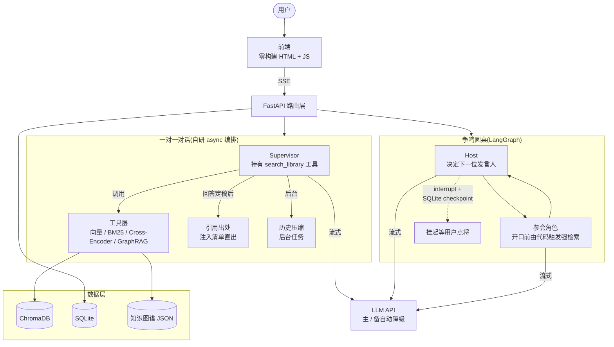

# 促膝

与人物对话的 AI 应用。荣格、阿德勒、王阳明、峰哥、张雪峰五个人物各有独立人设、知识库与界面主题;另有**争鸣**(多人物圆桌交锋)与**传奇**(用户扮主角推进剧情)两种玩法。开源,Apache-2.0。

```
忠实度 8.94 / 相关性 9.75 / 口吻一致性 8.74   自建 166 题 LLM-as-Judge 五维评测
寒暄首字 ~2s / 检索端到端 ~2.4s / 重复提问 0.05s   单机 CPU 实测
pytest 453 个用例   覆盖编排 / 检索 / 状态隔离 / 异常处理
```

一次由评测驱动的修复:首轮评测王阳明忠实度 4.25,归因是传记语料缺失而非检索问题,补语料后 4.25 → 9.54。详见[评测](#评测)一节。

---

## 截图


---

## 快速开始

环境要求:Python 3.10+

```bash
# 1. 安装依赖
uv sync --extra dev          # 或 pip install -e ".[dev]"

# 2. 初始化语料(解析 md/pdf → 分块 → 向量化 → 写入 ChromaDB)
python init_persona_data.py

# 3. 启动服务
python main.py               # 默认 http://localhost:8000
```

**配置模型 API**:本项目不内置任何 Key。推荐浏览器里填——启动后打开首页,首次访问弹出配置页(内置 DeepSeek / 百炼 / 智谱 / Kimi 预设,可先测试连接);无头部署用 `cp .env.example .env` 填三个变量。

启动后:对话页 `/`、API 文档 `/docs`、管理后台 `/admin`(用量 / 图谱状态 / 反馈,上线前设置 `MONITOR_TOKEN`)。

---

## 架构



两条链路的分工由控制流的形状决定:

| 维度 | 一对一 | 争鸣圆桌 |
|---|---|---|
| 编排 | 自研 asyncio,无状态图 | LangGraph,图上有环 |
| 谁决定下一步 | 模型决定查不查、查多深(工具参数 `strong`) | Host 决定下一位发言人 |
| 挂起 | 不需要,请求级无状态 | `interrupt()` + SQLite checkpoint,重启可恢复 |
| 收敛 | 单次回答即结束 | 发言配额与调用上限,子角色之间没有连边 |

`strong` 是检索深度分档,不是开关:`true` 走完整管线出 6 条带来源,`false` 只取向量+BM25 top-3 作"模糊印象"。选择权在模型——工具描述里写清什么情况用哪档。

---

## 检索管线

向量 + BM25 双通道 → RRF 融合(每类一票,类间与来源加权)→ 前 3 条免精排直通 + 其余 Cross-Encoder 精排选 3 → 注入 6 条完整原文。知识图谱按需触发:查询命中的图谱实体未被文本覆盖时,BFS 两跳子图并入证据,标注为推断。

几个有记录的取舍(完整推导见 [`docs/engineering-notes.md`](docs/engineering-notes.md)):

- **Multi-Query + HyDE 整体删除**。实测改写 3.5s+ 超预算、生成率 93% 但三轮实验测不出质量增益——删了整条链路和四个配置项。
- **索引块数 -97.4%**。扫描件 OCR 逐行碎片拼接去重后重新分块,18.8 万块 → 4,965 块,检索质量反而提升。
- **来源可信度加权**。二手解读强降权(0.25),防第三者评价冒充本人原话;代价是《被讨厌的勇气》里的流行概念排不进 top-K——这个冲突还没解掉。
- **精排分数 LRU 缓存**(2000 条,含内容指纹):重复提问精排零推理。
- **块尾续接**:按页分块导致 64% 的块断在句中,注入时用 metadata 把下一块首句补上,只写 metadata 不重建索引。

---

## 几个工程问题

### 寒暄不再走完整检索

用户问「你好」也走完检索全链路才调模型。把「什么时候该查」写进检索工具的描述,由模型判断,寒暄类一次 LLM 直出(首字 ~2s)。代价是模型会漏判/多判——漏判丢依据、多判多两秒,所以工具描述倾向「不确定就查」。

### 上游返回空响应

网关偶发「HTTP 200 但 content 为空」,流式挂 13 秒返回空壳。空壳视为失败立即重试(仅未推送 token 时,不会重复输出),流式加首 token 超时。单次失败代价 13s → 6s。代码:`src/core/llm.py`。

### 并发下的配置串扰

多用户并发时全局配置会串(LLM 配置放全局变量,A 用户可能用上 B 的模型)。`contextvars.ContextVar` 做请求级隔离。代价:跨线程/后台任务要显式带上下文,圆桌耗时统计因此改存 state。

### 引用出处不单独跑核查

曾经回答定稿后异步跑 verifier 逐条核查论断,前端最多等 15 秒。删掉——出处随检索 metadata 进来,注入清单直出编号对应的引用,零额外调用。

---

## 评测

### 166 题 LLM-as-Judge(五维,0-10)

覆盖 5 位人物(荣格 52 / 阿德勒 40 / 王阳明 40 / 峰哥 17 / 张雪峰 17),全部产出可解析评分:

| 指标 | 得分 |
|---|---|
| 忠实度 | **8.94** |
| 回答相关性 | **9.75** |
| 上下文精确度 | **8.19** |
| 要点覆盖率 | **9.44** |
| 口吻一致性 | **8.74** |

第五维「口吻一致性」衡量说话像不像本人,与忠实度(有无事实依据)分开计分。

### 失分模式

按角色的忠实度:王阳明 9.28 / 阿德勒 8.97 / 荣格 8.94 / 张雪峰 8.53 / 峰哥 8.47。三类集中问题:语料覆盖不到时模型补训练知识(峰哥最低,语料截止 2024)、来源加权与概念覆盖的冲突(阿德勒)、术语检索精度。RAGAS 三维(53 题)作对照诊断,与 LLM-as-Judge 不能横比,原因与原始数据见 [docs/eval-report.md](docs/eval-report.md)。

### 一次评测驱动的修复

首轮评测王阳明忠实度仅 4.25。逐题查看发现检索精度与其他角色持平——是传记语料缺失,不是检索坏了。补语料重测,原 0 分题升到满分,该角色 4.25 → 9.54。这件事定了后来的方法论:**先归因,再动手;该修语料时别动检索**。

评测集 = 内置 12 题 + 扩充 154 题(带角色字段),扩充题按「词条在语料里的出现次数」筛过,语料里查不到的概念已换题。

---

## 性能

| 指标 | 数值 | 条件 |
|---|---|---|
| 寒暄首字 | ~2s | 模型判定免检索,一次 LLM 直出 |
| 完整单请求 | 中位 11.5s / P90 21.9s | 166 题评测记录,CPU 单机 |
| 文本检索阶段 | 中位 1.90s | 含向量 + BM25 + 融合 + 精排 |
| 重复提问精排 | 0.05s | LRU 缓存命中 |
| 20 并发 | 全部成功 | 本地压测,瓶颈在 CPU 精排不在上游 API |

---

## 技术栈

| 层 | 技术 |
|---|---|
| 后端 | FastAPI;一对一自研 async 编排,争鸣 LangGraph |
| 检索 | ChromaDB + bge-small-zh-v1.5 / rank-bm25 / bge-reranker-base(int8 量化) |
| 前端 | 原生 HTML/CSS/JS,零构建 |
| 持久化 | SQLite(会话/账号/用量/反馈)+ ChromaDB + 图谱 JSON |
| 评估 | 166 题 LLM-as-Judge 五维 + RAGAS 对照 + pytest 453 用例 |

---

## 项目结构

```
├── main.py                        # FastAPI 入口(启动预热 + 会话恢复)
├── init_persona_data.py           # 语料入库
├── framework/                     # 编排层:supervisor / 圆桌 / 传奇 / 场景运行时
├── scenes/persona_chat/           # 角色定义 / 提示词装配 / 角色卡 IO
├── src/api/                       # REST + SSE 路由 / 限流鉴权 / 评测端点
├── src/core/                      # 配置 / LLM 客户端 / 会话 / 监控
├── src/retrieval/                 # 嵌入 / 分块 / 混合检索 / 重排 / 图谱 / 块尾续接
├── data/persona_chat/             # 各人物语料(不进仓库,见合规)
├── frontend/                      # 零构建前端
├── scripts/                       # 建图战役 / RAGAS / 压测等脚本
└── tests/                         # 453 个用例
```

更多工程细节(检索参数三次推演、分块实测、上游故障排查、并发原始数据)在 [`docs/engineering-notes.md`](docs/engineering-notes.md)。

---

## 数据维护

```bash
# 重灌某个人物 + 失效其 BM25 磁盘缓存
python -c "import init_persona_data; init_persona_data.load_character_data('fengge')"
python -c "from src.retrieval.advanced_search import invalidate_bm25_cache; invalidate_bm25_cache('persona_fengge')"
```

| 人物 | collection | 块数 | 语料 |
|---|---|---|---|
| 荣格 | `persona_jung` | 2,988 | 原著 + 演讲与回忆录 |
| 王阳明 | `persona_wangyangming` | 1,269 | 传习录 + 传记精选 |
| 阿德勒 | `persona_adler` | 1,192 | 原著 + 演讲 + 后人转述(降权) |
| 张雪峰 | `persona_zhangxuefeng` | 161 | 著作 + 采访 + 语录(截止其离世,仅生前言论) |
| 峰哥 | `persona_fengge` | 90 | 2024 媒体专访 + 公开言论整理 |

---

## 许可与合规

代码 Apache-2.0。**原始语料不进仓库**:三位思想家为受著作权保护的已出版著作,需使用者自行准备合法来源;峰哥、张雪峰素材为公开言论整理。两位取材于当代真实人物,商业化使用前须取得授权或移除该角色;所有回答均为 AI 生成,不代表本人观点。
